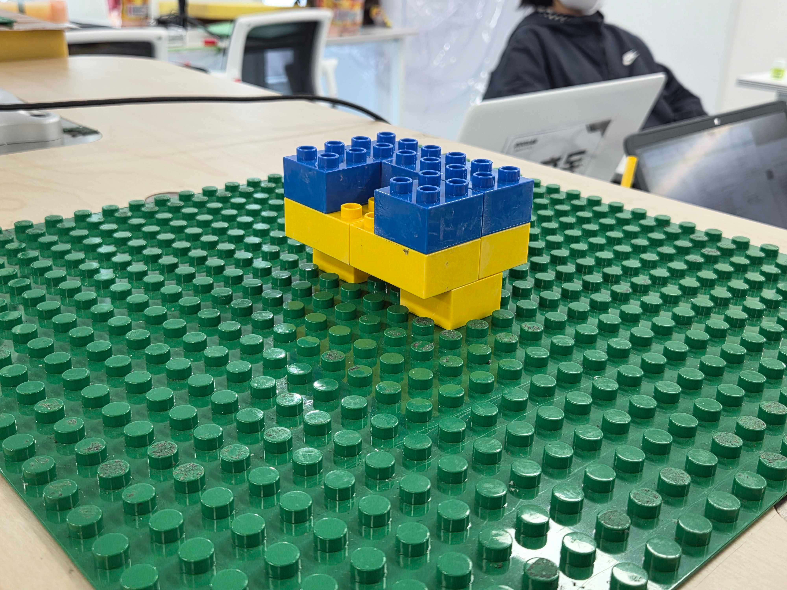
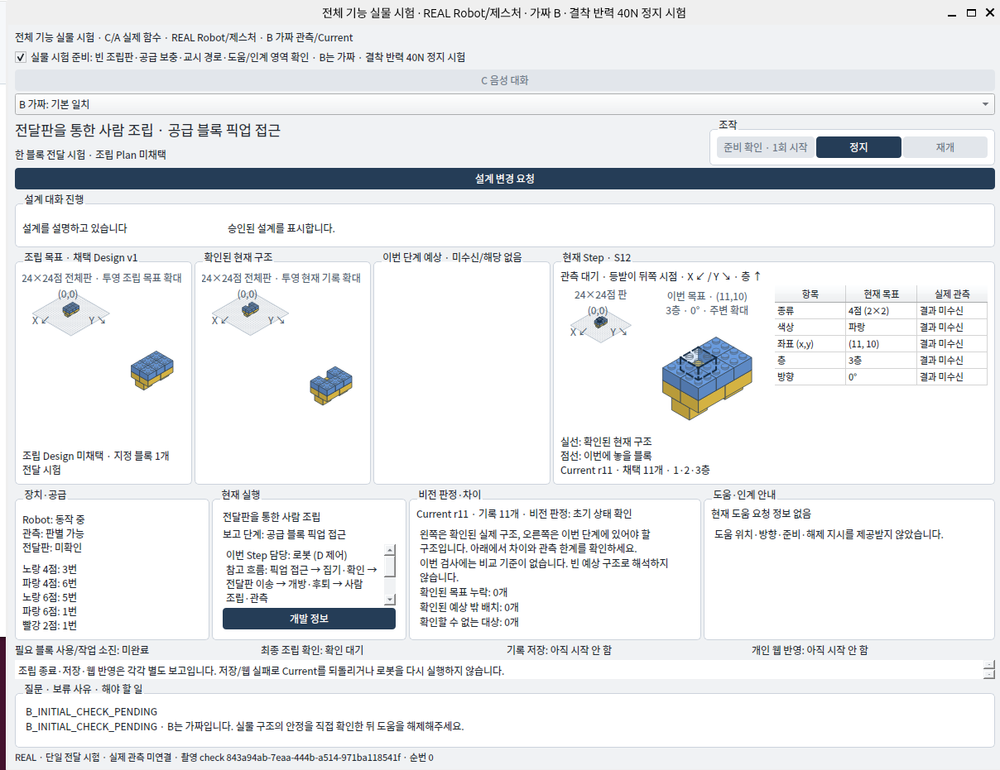

# Adaptive Co-Assembly
### 대화형 블록 설계와 사람–로봇 협업 조립

사용자와 대화로 블록 의자를 설계하고, 조립 순서와 필요한 사람의 도움을 계산해 협동로봇 실행으로 연결하는 팀 프로젝트입니다.

로봇이 수행하는 집기·이송·결착과 사람이 제공하는 지지·조립 도움을 연결하고, 진행 상황과 작업 결과를 HMI와 웹에서 확인하는 흐름을 개발합니다.

**기간:** 약 2주 · 2026년 10월 16일 종료 예정

**상태:** 개발·통합 검증 진행 중

> 설계·계획·HMI·모의 로봇의 통합 실행과 일부 실물 시험 기록이 있습니다.
> 현재 통합 실행의 조립 상태 검사는 합성 관측을 사용합니다.
> 실제 카메라를 포함한 전체 조립 완료 검증은 아직 완료되지 않았습니다.

## 시험 장면



*실물 시험 중인 블록 구조물입니다. 전체 실물 조립의 완료 여부는 아래 검증 범위를 참고합니다.*

<details>
<summary>HMI 시험 화면</summary>



설계 목표, 현재 구조, Step별 진행, 공급 상태와 작업 결과를 표시합니다. 첨부 화면의 B 관측은 합성 데이터이며 실제 카메라 검사 결과와 구분합니다.

</details>

## 주요 기능

- **대화형 설계:** 사용자 요청으로 블록 배치 후보를 생성하고 미리보기·수정·승인을 거쳐 목표를 확정합니다.
- **조립 계획:** 설계와 현재 배치를 바탕으로 조립 순서, 사람의 도움, 실행 직전 재평가와 이동 후보를 계산합니다.
- **협업 실행:** 로봇 동작과 사람의 준비 응답을 연결하고 HMI에서 진행·정지·재개를 관리합니다.
- **상태 검사:** 기대 상태와 관측 결과를 비교하고 확인된 조립 상태와 변경 이력을 관리합니다.
- **기록·웹:** 사용자별 설계·작업 결과를 저장하고 웹 조회와 도안 공개 선택 기능을 제공합니다.

## 동작 흐름

사용자 요청 → 설계 후보·미리보기 → 사용자 승인 → 조립 계획·사람 도움 계산 → 로봇·사람 협업 → 상태 검사 → 결과 저장·웹 조회

설계 생성, 계획 계산, 상태 검사, 실행 제어의 책임을 분리합니다. 승인된 설계와 최신 조립 상태를 기준으로 작업을 계산하며, 로봇 명령 완료와 조립 확인을 구분합니다.

작업 과정은 JSONL로 기록합니다. 조립 판정과 DB 저장 결과도 별도로 관리하여 저장 실패 때문에 물리 작업을 반복하지 않도록 구성합니다.

## 현재 구현과 검증 범위

문서는 main, 구현·통합 시험은 `codex/integration-round1`의 `ebeeef2`를 기준으로 합니다. 아래 로컬 개선은 이 공개 기준과 별도로 기록합니다. 기준일은 2026년 10월 13일입니다.

| 영역 | 현재 구현 | 확인 수준·남은 작업 |
|---|---|---|
| 설계·계획 | 후보 생성·수정·승인, 조립 순서·사람 도움·이동 후보 계산 | 소프트웨어 통합과 일부 실제 LLM 시험 기록. 전체 음성 흐름은 추가 확인 필요 |
| 로봇·HMI | 집기·이송·인계·결착, 준비 응답, 진행·정지·재개 | 실물 부분 시험 수행. 미조립 블록이 남은 시험이 있으며 최신 공급 정책의 실물 재시험 필요 |
| 상태 검사 | 기대 상태 비교, 현재 배치와 revision 관리 | 현재 통합은 합성 관측 사용. 실제 카메라 기반 전체 판·최종 상태 검사 연결 필요 |
| 저장·웹 | JSONL·PostgreSQL, 로그인·소유권, 조회·공개 선택 | 개별 시험 기록. 실물 최종 판정부터 저장·조회까지 전체 연결 추가 확인 필요 |
| 시뮬레이션·장애물 회피 | Isaac Sim·MoveIt 적용 계획 | 조립 대상과 사람 주변의 장애물 회피에 활용 예정. 현재 통합·실물 검증 미완료 |

**최근 로컬 개선:** 공급 슬롯 6번 접근 문제로 블록 1개가 미조립된 시험 이후, REAL 시험의 공급 순환을 종류·색상별 `1→2→3→4→5→1`로 제한했습니다. 1~5번은 항상 보충되고 6번은 비어 있다는 운영 전제를 사용합니다.

이 변경은 기존 공급판 좌표 모델과 교시를 유지하며 관련 검사 57개를 통과했습니다. **슬롯 정책 코드는 아직 GitHub에 게시되지 않았으며 실물 재시험 전입니다.**

- **MOCK:** 실제 설계·계획·상태 처리 함수와 가상 로봇·합성 관측을 연결합니다.
- **REAL 진입점:** 실제 로봇에 연결하지만 조립 상태 검사 입력은 현재 합성 관측입니다.
- **이동 후보:** 전체 로봇 궤적·IK·충돌 회피 검증 결과와 구분합니다.

[최신 실행 구성](docs/RUN.md) · [통합 개발·시험 기록](https://github.com/suuuhululu/C-2/blob/ebeeef2a861abd2ab69257e7b083c4ded2a971cc/docs/STATUS.md)

## 기술 구성

| 영역 | 주요 기술 | 사용 목적 |
|---|---|---|
| 설계·대화 | Python, OpenAI API — GPT-4o mini·GPT-6.1 Sol | 설계 생성·수정, 사용자 의도 해석, 음성 입출력 연동 |
| 계획·계산 | NumPy, SciPy, jsonschema | 조립 순서·기하·사람 도움·이동 후보 계산과 데이터 검증 |
| 로봇 제어 | ROS 2 Jazzy, DRCF2 | Doosan M0609·OnRobot RG2 제어 연결 |
| HMI·제스처 | PyQt5, MediaPipe | 작업 상태 표시, 사용자 입력·손 제스처 응답 |
| 저장·웹 | PostgreSQL, psycopg, Python HTTP 서버, HTML/CSS/JavaScript | 사용자별 기록 저장·조회와 도안 공개 |
| 비전 개발 | OpenCV, Ultralytics YOLO, PyTorch, RealSense | 블록·손 인식과 카메라 관측 모듈 개발 |

Isaac Sim·MoveIt은 별도 개발·검증 대상으로 관리하며 현재 main의 기본 실행 구성에는 포함하지 않습니다. 비전 모델·카메라 개발 원본 역시 실행용 main과 구분해 보존합니다. 세부 설치 조건은 [환경 설정](docs/INSTALL.md)을 참고합니다.

## 코드 구조

현재 main의 주요 경로입니다.

```text
C-2/
├── app/                        # 설계·HMI·통합 실행
├── planning_trial/             # 조립 계획·재평가·이동 후보
├── perception/                 # 상태 검사 연결
├── robot_control_integration/  # 로봇 실행·제스처·교시
├── history/                    # DB·웹·작업 이력
├── scripts/                    # 현장 실행 보조
├── docs/                       # 설치·운영·모듈 연결
├── requirements.txt            # 기본 계산·HMI 의존성
├── requirements-history.txt    # DB 의존성
└── README.md
```

통합 테스트와 상세 개발 자료는 [integration round 1](https://github.com/suuuhululu/C-2/tree/codex/integration-round1)에서 확인할 수 있습니다.

## 장치 없이 실행하기

Ubuntu 24.04 / Python 3.12.3이 문서의 기준 환경입니다. GUI 실행에는 Qt 시스템 라이브러리와 화면 환경이 필요합니다.

```bash
git clone --branch main --single-branch https://github.com/suuuhululu/C-2.git
cd C-2

python3 -m venv .venv
source .venv/bin/activate
python3 -m pip install -r requirements.txt

C_DESIGN_USE_LLM=0 python3 -m app.mvp_integration \
  --robot-root ./robot_control_integration \
  --c-mode offline \
  --log-directory logs/mvp-integration
```

외부 API와 DB를 설정하지 않은 환경에서 설계 요청·미리보기 승인·계획 계산·가상 로봇 진행·합성 관측 검사를 확인합니다. 설계와 제약에 따라 계획이 보류될 수 있습니다.

위 명령은 공개 main을 실행하며, 미게시 로컬 변경은 포함하지 않습니다. 실제 LLM·음성, DB·웹, 로봇·카메라에는 별도 환경 준비가 필요합니다.

- [설치·환경 설정](docs/INSTALL.md)
- [통합 실행·DB·웹·현장 시험](docs/RUN.md)
- [모듈 연결과 책임 범위](docs/INTEGRATION.md)

## 팀 역할

| 팀원 | 주요 담당 |
|---|---|
| 시율 | 설계 대화, 수정 후보, 승인·사용자 의도 해석 |
| 세은 | 조립 계획, 사람 도움·이동 후보 계산, Isaac Sim 시뮬레이션 |
| 홍동 | Vision, 기대 상태 비교, 현재 배치·revision 관리 |
| 수현 | 로봇 실행, 검사 요청·진행 관리, HMI·제스처, DB·웹, 통합 |

통합 원본·실측·검사·비전·시뮬레이션 자료는 [통합 보존 기준](https://github.com/suuuhululu/C-2/tree/archive/integration-20261013-ebeeef2)에 있습니다. [이전 main](https://github.com/suuuhululu/C-2/tree/archive/main-20261013-afd75d0)과 [파일 보존 명세](https://github.com/suuuhululu/C-2/blob/codex/archive-runtime-20261013/ARCHIVE_MANIFEST.json)도 유지합니다.
