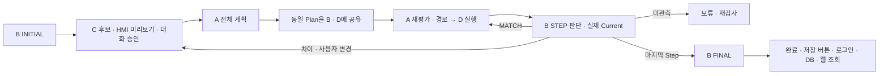

# 최종 MVP 모의 통합 실행·실측 입력 안내

> **2026-10-12 최신 문서 기준:** [최종 대화 반영·원격/로컬 상태](16_FINAL_INTEGRATION_CHAT_SYNC_20261012.md)와 [발표·배포 문서 10종](final_mvp/README.md)을 우선합니다. B가 Expected/전체 판 비교/Current·revision, D가 실행·지정 검사·진행/HMI/제스처/기존 이력·웹을 맡습니다. A 3분류 호출과 후보 실행권 분리는 유지합니다. 로컬 D 수정·계획 실패 KEEP 보류와 원격 미반영 상태를 구분하며 아래 본문은 이전 시점 기록으로 보존합니다.

## 현재 실행 가능한 범위

이번 사용자 결정에 따라 A·B·C 실제 Python 함수, D 진행부, 별도 MOCK 로봇 프로세스, Qt HMI, JSONL을 연결했다. 완료한 모의 작업의 개인 저장·웹 조회는 기존 PostgreSQL/웹 기능에 연결했다. 로봇·Camera·제스처는 가짜 입력이며 Isaac 시뮬레이션이나 실물 시험 결과가 아니다.

2026-10-12 갱신: PR #24는 integration에 `8914320`으로 병합됐다. 현재 시험 코드 업데이트는 `codex/current-runtime-update-20261012`에서 준비하며, 원래 실물 실행 폴더와 ZIP은 보존한다. 업데이트 PR 병합 전에는 이 코드가 integration 원격에 들어갔다고 해석하지 않는다. 실행·검증·남은 항목은 [최신 업데이트 안내](13_RUNTIME_UPDATE_20261012.md)를 우선한다.

이 진입점에서 B가 Current/revision·Expected·Difference를 소유한다. 이전 Day4 Backend 비교 경로는 함께 호출하지 않는다. 기존 Day4 진입점은 별도로 유지한다.

## 확정한 운영 방식

| 항목 | 이번에 반영한 결정 |
|---|---|
| C 설계 | 후보를 HMI에 표시 → 표시 완료 → C 대화 검토 → APPROVE 후 A 계산. MODIFY는 새 후보 표시·재검토 |
| 계산 가능한 설계 | 샘플에 한정하지 않고 승인 Design을 A에 전달. 허용 종류·색·방향·층·40블록과 실제 계산 가능성을 별도로 검사 |
| A 계산 | 전체 계획 / 실행 직전 재평가 / Step 경로를 분리. 후보는 계속 `execution_allowed=false`; D가 현재 요청을 검증해 실행 요청 발급 |
| B 비교 | D가 INITIAL/STEP/FINAL을 지정. B 결과와 revision을 그대로 중계; D의 공간 재비교·revision 재발급 없음 |
| KEEP | 승인 목표 유지 + 최신 실제 Current로 A 재계획. 불일치 Step을 완료로 기록하지 않음. A가 사람 정리를 요구하면 정리 대기 |
| 계산 불가 | NO_FEASIBLE_ORDER/SEARCH_LIMIT → 이유를 가지고 C 대화. 입력·설정 오류는 보류하며 정상 계산 불가로 위장하지 않음 |
| 사용자 설계 변경 | 현재 Step 실행·B 확인을 마치고 다음 Step을 보류한 뒤 C 호출. 계산 중 요청이면 실제 실행 전에 보류 |
| 직접 체결 | 공급 집기 → 파지 유지 이송 → pre-contact 실제 도달/정지 → D Contact → 개방/후퇴 → B 검사 |
| 도움 준비 | pre-contact 정지 후 활성 HELP_READY 요청의 엄지척. 별도 준비 버튼이나 시간 경과 승인 없음 |
| PRESS_AND_HOLD | 엄지척 후 near-contact에서 놓기·후퇴, 사람 누르기/잡기 도움, 최대 10초 완료 신호 대기, B 확인 후 해제 안내. Robot force press를 추가하지 않음 |
| 전달판·직접 인계 | 상공 3초 대기. 새 손 없음 근거 → 하강/정지 확인/개방/후퇴. 손 있음+받을 준비 → 하강 전 직접 인계. 손 있음+미준비 → 계속 파지/대기 |
| 사람 조립 확인 | 완료 엄지척 최대 10초 대기 후 B 검사. 제스처나 로봇 완료 자체를 조립 완료로 기록하지 않음 |
| STOP·재개 | 즉시 요청 취소. STOP_ACCEPTED는 접수, STOP_VERIFIED는 정지 근거. 동일 Step/프로필·최신 B 상태를 확인한 후 남은 동작만 재개; 집기/Contact 결과 불명확은 복구 판단 대기 |
| 제작자·저장 (10/12 갱신) | DB 설정 시 제작자 로그인 → 시작 시 제작자 고정·초기 JSONL 적재/소유자 연결 → B FINAL 완료 → ‘개인 이력 저장’ 클릭 → 같은 제작자로 나머지 JSONL 적재·저장 영수증 → 같은 로컬 웹에서 인증·조회 확인. 웹 공개는 별도 선택 |
| 저장 실패 | 조립·저장·웹 상태를 분리. 실패 시 작업 로그와 Current 보존, 로봇 재실행 없음 |

지원 입력은 24×24 stud, 1~5층, 1~40블록이다. 노랑/파랑은 2x2x1(0°)·2x3x1(0°/90°), 빨강은 1x2x1(0°/90°)이다. `ROBOT_RELEASE_PRESS`는 제외한다. 공급 파지는 패드 하단=블록 밑면+5mm, pre-contact 계산 기준은 잡은 블록 밑면=아래 stud 끝+20mm다. 이 기준만으로 실측 TCP·보정·제어값이 검증되었다고 보지 않는다.

## 1. 장치 없이 한 화면에서 실행

기존 프로젝트 환경의 PyQt5/numpy/scipy/jsonschema를 사용한다. 설치 목록을 새로 늘리지 않았다. DB를 사용할 때만 기존 `.venv/history-deps` 또는 `requirements-history.txt` 환경의 psycopg가 추가로 필요하다.

```bash
cd /home/ms-02/C_2
C_DESIGN_USE_LLM=0 python3 -m app.mvp_integration \
  --robot-root '/home/ms-02/C-2_협동2자료/work/c2-virtual-inputs-20261011/D_robot_control_integration_20261011/robot_control_integration_20261010' \
  --design interfaces/fixtures/mvp_fake_design.json \
  --log-directory logs/mvp-integration
```

1. DB 설정이 있으면 상단 ‘제작자 로그인’을 먼저 누르고, ‘시작’을 누른다. DB 설정 없는 독립 모의 시험은 기존처럼 바로 시작한다. B INITIAL은 가짜 전체 영역 관측으로 현재 상태를 확인한다.
2. 제공한 5층 후보가 미리보기에 표시된다. 아래 C 답변란에 ‘좋아 이걸로 하자’를 입력한다. APPROVE 전에는 계획 실행이 시작되지 않는다.
3. A 계산과 MOCK 로봇 실행, 가짜 제스처·관측이 자동 진행한다. Step마다 B가 확인하고 마지막에 FINAL을 검사한다.
4. 한 화면에서 진행 5/5, Current r5, 최종 조립 일치, 기록 저장 ‘아직 시작 안 함’을 확인한다.
5. JSONL은 `logs/mvp-integration/<job_id>.jsonl`에 보존된다. DB 설정이 있으면 시작 시 제작자 소유권을 연결하되 저장 영수증·웹 공개는 아직 만들지 않는다. DB 설정 없는 독립 모의 시험에서는 DB 호출이 없다.

가짜 제스처는 준비를 즉시 응답하며 RECEIVE에는 새 손 없음 관측을 공급한다. 실제 도움 동작·사람 조립을 관측한 결과가 아니다. `--design`은 C 생성 결과 대신 명시적 시험 후보를 주입하는 옵션이다. C의 검토/승인과 A/B 계산은 실제 함수를 사용한다.

`--design`을 생략하면 C 생성 함수도 사용한다. 현재 offline C 기본 15블록 의자는 이 계산 설정에서 `NO_FEASIBLE_ORDER`이며 C 대화로 돌아간다. 허용 블록 규칙을 통과해도 조립 순서/도움 조건이 성립하는 것은 아니다. 모의 설정을 임의 완화하거나 다른 동작으로 대체해 성공으로 보고하지 않는다. 실제 LLM을 쓸 때는 `--c-mode live`, `C_DESIGN_USE_LLM=1`, 기존 `OPENAI_LLM_API_KEY`가 필요하며 이번 시험에서는 외부 API를 호출하지 않았다.

## 2. 개인 저장·웹 조회

기존 DB 계정과 초기화한 DB를 사용한다. `HISTORY_DATABASE_DSN`은 실행 환경에 제공하고 비밀번호를 실행 인자·로그·문서에 적지 않는다. 웹은 같은 DB를 대상으로 기존 로컬 서버를 실행한다.

```bash
cd /home/ms-02/C_2
PYTHONPATH=.venv/history-deps:. python3 -m history.web --port 8765
```

HMI도 같은 psycopg 환경과 `HISTORY_DATABASE_DSN`으로 실행한다. 기본 웹 주소는 `http://127.0.0.1:8765`다. 다른 로컬 포트를 쓰면 `HISTORY_WEB_URL`을 같은 주소/포트로 설정한다.

10/12 사용자 요청에 따라 시작 전 제작자 로그인을 연결했다. DB가 설정된 HMI 상단에서 기존 계정으로 로그인하고 시작하면 해당 사용자를 현재 Job의 제작자로 고정한다. 진행 중 계정 전환/로그아웃은 막고, 완료 후 계정을 바꾸어도 이전 Job 제작자는 바뀌지 않는다. 다른 계정으로 이전 작업을 저장할 수 없으며 새 작업을 시작할 때 새 제작자를 연결한다. 로그인 ID/비밀번호는 프로세스 메모리에서만 사용하며 snapshot·JSONL·문서·인자에 기록하지 않는다.

시작 시 초기 JSONL을 기존 적재부로 가져와 소유자를 연결한다. 연결 실패는 제작자 영역에 표시하며 원본 JSONL·제작자 선택·Current/실행 판단을 유지한다. 완료 후 같은 제작자로 저장하면 명시 재시도로 소유권 연결/나머지 적재/저장 확인을 수행한다. 타 소유자 Job은 변경하지 않는다. DB 저장 성공과 인증된 웹 저장 내용 조회 성공을 각각 표시한다. 웹이 꺼져 있으면 DB 저장은 유지되고 웹 실패만 표시한다. 공정 복원·자동 로봇 재실행·새 DB 표는 추가하지 않았다.

웹에서 같은 계정의 MY DESIGNS에 연결된 채택 도안을 관리하고 PUBLISH DESIGN/UNPUBLISH DESIGN으로 공개를 선택한다. 저장 버튼은 자동 공개하지 않는다. 방문자는 로그인 없이 공개 목표 모형과 층별 설계도를 본다. 현재 웹과 HMI는 반드시 같은 DB를 지정해야 한다. 10/11의 완료 후 로그인 기능은 DB 설정 없는 기존 호출/검사의 호환 경로로 보존하지만 일반 DB 설정 HMI는 시작 전 로그인을 사용한다.

로컬 검증은 203개 검사 결과 (원본 로컬 기록 경로: `../logs/history_web/hmi-creator-regression.xml`，소스 배포에 포함하지 않음)와 로그 (원본 로컬 기록 경로: `../logs/history_web/hmi-creator-regression.log`，소스 배포에 포함하지 않음)에 기록했다. 실제 PostgreSQL과 A/B/C 함수·별도 MOCK Robot을 사용한 제작자 로그인/시작/소유권/완료 저장/웹 확인 및 다른 사용자 새 Job 분리를 포함한다. 시작 시 DB 실패·완료 후 저장 재시도와 웹 실패도 검사했다. 1200×900/960×900 Qt 제작자 표시, 기존 Qt/단일 화면/진행/DB/웹 회귀 검사를 포함하며 실제 Robot/Camera·외부 배포·원격 integration 반영은 수행하지 않았다.

## 3. 내일 채울 실제 입력

전체 Plan의 모든 실측값을 먼저 채우라는 규칙은 추가하지 않았다. **현재 실행 Step의 값**을 D에서 제공하고 해당 Step을 확인한다.

| 입력 | 채울 내용 | 연결 위치 |
|---|---|---|
| 공통 프레임 프로필 | D 발급 ID/버전, Base/TCP, 보정·도구·속도 참조, 공급/조립/전달판 계산 설정 | 세 A request의 `frame_profile` |
| 공급 픽업 | 슬롯별 실제 `[X,Y,Z,A,B,C]` mm/deg·Base/ZYZ, 5mm 파지 기준, 닫기/개방 폭·피드백 범위 | `calculation_profiles.supply`, D Step `pickup_pose`/폭 |
| 조립 목표 | 기존 완전 체결 TCP 기준, 공통 설계↔trial 축/원점, 해당 크기/층/파지/회전의 실측 보정 | `calculation_profiles.assembly`, D Step `reference_pose`/`turn_base_z_deg` |
| 경로·전달판 | 검증한 상승 높이·공급 경유점·몸통 회피·전달판 TCP·실제 pre-contact 차이 | D 프로필과 A에 제공할 scoped 경유점/전달판 프로필 |
| 실행 설정 | 검증한 속도/가속도/힘/누름 한도, TCP/tool/domain/gripper 연결 | 기존 Robot config/D 프로필. Native35 검증 범위는 기존 4점·0° |
| 슬롯 예약 | 실제 종류/색·슬롯 ID·예약 ID/generation·소속 workflow·CONFIRMED/RESERVED 상태 | `reserved_supply_slot`; 두 generation의 숫자 동등 조건 없음 |
| RobotState | 최신 실제 TCP/정지/파지·활성 명령·시각/세대 | `robot_state`; 가짜 고정값 재사용 금지 |
| B 실제 관측 | 안전한 관측 위치/정지 후 Observed를 생성하는 실제 callback, 보정·가림·영역 정보 | `connect_inspection(..., observe=실제콜백)` |
| 제스처·손 | 활성 요청 ID에 연결된 엄지척, 전달판/직접 인계의 손 있음·받을 준비·새 관측 시각/sequence | Robot `SIGNAL`; 현재 FAKE 자동 응답을 실제 producer로 교체 |
| 실행 세션 | 현재 Step의 실행 ID, 최신 B revision, D 예약·재평가·RobotState 수신 근거 | 기존 `session.d_runtime`/REAL 검사 |

완전 체결 TCP에 중심 0.5 stud·기존 228mm·파지 오프셋을 다시 더하지 않는다. −2mm는 실기 시험 후보이며 기본 실행값으로 승격하지 않는다. `app/mvp_fake.py`의 가짜 숫자를 REAL에 복사하지 않는다.

Robot의 빈 실제 양식은 Robot 루트 `settings/integration_runtime/real-step.template.json`이며 상세 설명은 [기존 로봇 실행 가이드](D_ROBOT_INTEGRATION_RUN_GUIDE.md)를 따른다. `app.mvp_integration`의 공개 실행은 현재 FAKE 전용이다. 실제 프로필을 채우는 것 외에 위 실제 B/제스처·관측 위치 이동과 D 준비 입력/REAL 세션을 연결해야 한다. FAKE 명령의 모드만 REAL로 바꾸어 전체 공정을 실행할 수 있다고 보고하지 않는다.

## 구현 위치와 흐름

| 파일 | 책임 |
|---|---|
| `app/mvp_workflow.py` | D 상태/요청·B 판정 대응·공유 Plan·진행/STOP/C 변경/최종 완료/JSONL |
| `app/mvp_calculation.py` | 승인 Design·고정 Plan 기준·최신 B Current를 세 A 요청으로 연결 |
| `app/mvp_integration.py` | 모의 실행, 작업 thread→D 결과 큐, Qt 입력, 별도 Robot 프로세스, 인증 저장·웹 확인 |
| `app/mvp_fake.py` | FAKE 설정·예약·D 프로필과 시험 실행 문서. REAL 설정 아님 |
| `history/mvp_save.py` | 기존 인증/적재/소유권/저장 영수증/인증된 웹 조회 재사용 |
| 기존 Qt HMI | 단일 페이지 C 답변·설계 변경·진행/도움·재검사·완료 후 개인 저장 |
| Robot `app/integration_runtime.py` | 기존 검증된 이동/파지/Contact 호출, 분기·요청·STOP/checkpoint |
| Robot `app/integration_motion_binding.py` | A 픽업 접근/파지 이송 후보와 D 경유점·pose 대조. IK/전체 팔 충돌 검증 아님 |



기존 Day4 직접 D 비교를 최종 MVP 경로와 동시에 수행하지 않는다. A 결과는 schema/context·Current·프로필·예약/평가 연결을 검사하고, STOP/변경 뒤 옛 결과를 채택하지 않는다. Expected는 고정 Plan 기준으로 구성하며 실제 deviation으로 덮어쓰지 않는다. 로그 쓰기 실패도 진행을 보류하고 STOP을 요청한다.

## 검증 결과와 남은 확인

최종 검사 수치는 검증 기록 (원본 로컬 기록 경로: `../logs/mvp-integration-verification/verification.json`，소스 배포에 포함하지 않음)을 따른다. 서로 중복되는 검사 집합은 합산하지 않는다. 모의 정상 5층, 빨강 0°/90°, 사람 전달판 경로, A/D 빈 접근 경로 불일치 거절, INITIAL 부분 확인 보류, FINAL 새 근거 없음 보류, 불일치 KEEP 재계획, 변경 대기, STOP·옛 결과, 개인 인증·소유권·저장·웹 조회를 검사했다.

미검증은 실제 Camera/Robot/제스처·LLM API·ROS 관측 위치 이동·실물 5mm 파지/회전/TCP/힘·Isaac/IK/전체 팔 충돌·다른 환경의 UI/연결이다. 모의 자동 신호는 실물 도움 준비 근거를 대신하지 않는다. REAL 연결 및 실물 협업에서 도움 유지/해제와 복구를 실제 상태로 확인해야 한다. 기존 lint/type check는 미구성이며 새 도구를 도입하지 않았다.
