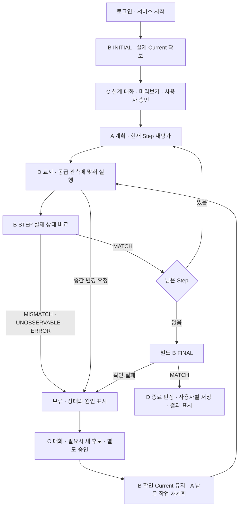

# Round3 서비스 최종 통합 실행·안내 가이드

기준: 2026-10-15, `codex/integration-round3` / 로봇 제어 기반 `93ef967`와 후속 서비스 연결 변경. 목표는 제한된 설계에서 설계·조립·중간 변경·최종 확인·사용자별 저장을 연결하는 것이다. 공급판 정밀도 개선을 반복하는 작업으로 확대하지 않는다.

다른 PC·새 채팅에서는 [인계 안내](D_ROUND3_HANDOFF_20261015.md)를 먼저 읽는다. 최근 INITIAL은 V0 상태 조회 시간 초과와 STOP 서비스 부재로 HOLD였고, 실제 정지·HOME 복귀·Current 확보가 확인되지 않았다. 새 실행 전에 이 실패를 진단한다.

현재 C 승인→실제 A 첫 Step→대응 교시·공급 프로파일→D 한 Step 연결과 별도의 B INITIAL 실행기가 구현·모의 검사된 상태다. INITIAL은 round3 로봇 드라이버와 round2의 관측 연결을 사용한다. 후속 작업으로 실제 B STEP/FINAL 관측 연결·한 Step 결과 대응·웹 확인 재시도를 구현했다. native 종료 후 관측 시작 상태로의 인계와 남은 native Step 연결은 아직 개발이 필요하다. 실물 전체 서비스 통과를 뜻하지 않는다. 아래의 **실행 가능**, **개발 필요**, **실물 확인 필요**를 각각 기록하며 진행한다.

## 1. 최종 서비스 흐름과 안내 방식



보류 원인에 따라 재관측·오류 해결·C 의도 확인을 선택한다. UNOBSERVABLE/ERROR만으로 새 설계를 자동 승인하지 않는다. C가 KEEP를 반환해도 B MATCH나 실행 허가로 해석하지 않는다.

매 안내는 다음 다섯 항목으로 한다. 한 단계의 결과를 확인한 뒤 다음 단계의 실행을 안내한다.

1. 현재 단계와 이번 작업의 완료 기준.
2. 지금 수행할 명령 또는 조작 한 묶음.
3. 정상일 때 나오는 상태·화면·파일.
4. 확인할 증거: 출력, job/check/execution ID, 해당 결과 파일 경로.
5. 실패 시 멈출 위치와 다음 진단. 자동 재실행으로 물리 동작을 반복하지 않는다.

모든 정상 Step에 별도 수동 승인을 추가하지 않는다. 승인 대상은 C 설계 후보이며, 기존 native의 관측·정렬·지원 팝업은 현재 시험 절차로 유지한다. 서비스 자동화에 필요한 팝업 정리는 별도 작은 작업으로 검증한다.

## 2. 진행 순서

| 단계 | 실행·개발 작업 | 현재 상태 | 다음 단계로 갈 기준 |
|---|---|---|---|
| 0 | 코드·공급 프로파일 무동작 검사 | 명령 있음 / 이 PC 통과 | 25슬롯 검사·native 3개 preview, 장치 연결·동작 0 |
| 1 | #55의 INITIAL 3시점과 기존 D 관측 경로를 round3에 연결 | 구현·모의 검사 / preview 통과 | INITIAL만 실행하는 CLI, D3 상태 진단·취소·단일 writer 검사 |
| 2 | 현장 준비와 B INITIAL 한 번 | 실물 확인 필요 | 실제 8블록 Current 확보, 세 View 저장, HOME 복귀·제어권 해제 확인 |
| 3 | C 승인→A 실제 첫 Step→D 한 번 | 코드 있음 / 실물 확인 필요 | 실제 A Step과 native 교시·슬롯 일치, 물리 실행 로그, 이후 HOLD 유지 |
| 4 | D 결과→실제 B STEP→남은 Step | 관측/결과 연결 구현·모의 검사 / native 인계·연속 실행 개발 필요 | B MATCH 뒤에만 다음 Step, 다른 결과에는 보류 |
| 5 | 남은 블록·슬롯·지원 방식 연결 | 조건부 공급 설정 있음 / 조립별 연결·실물 확인 필요 | 필요한 실행 대상에 대응 교시/skill이 연결되고 실제 B로 각 Step 확인 |
| 6 | 중간 변경·조립 차이·별도 승인·재계획 | MOCK 근거 있음 / 실물 연결 필요 | 최신 B Current 보존, 새 설계 승인, 이미 완료한 조립을 반복하지 않음 |
| 7 | 별도 FINAL B와 D 종료 판정 | 관측/판정·저장 전제 코드와 모의 검사 / 실물 전체 도달 필요 | 필요한 블록 사용 종료와 새 FINAL MATCH가 모두 확인됨 |
| 8 | 사용자별 저장·조회·실패 재처리 | 기존 계정/이력 + 웹 단독 재시도 구현 / 실제 DB·웹 통합 확인 필요 | Job 소유자와 결과 일치, 저장·조회 성공, 실패가 화면에 표시됨 |
| 9 | 처음부터 끝까지 제한 서비스 인수 시험 | 앞 단계 후 수행 | 정상·변경·불일치·관측 불가·정지·저장 실패 경로 증거 확보 |

실행 중 문제를 발견하면 해당 단계에서 작은 수정과 관련 검사를 마친 뒤 같은 단계의 미확인 항목을 확인한다. 이미 확보한 공급판 측정값·힘·속도를 서비스 연결 문제 때문에 다시 조정하지 않는다.

## 3. 0단계 — 지금 실행할 무동작 검사

현재 로봇 PC에는 사용자가 지정한 현장 원본 `execution-approved-20261015/profile.json`을 보존한다. Git 공유·다른 경로 재현에는 같은 실행 수치·승인 범위를 묶은 `execution-portable-20261015/profile.json`과 그 폴더의 `scenario.json`을 함께 사용한다. 서로 다른 폴더의 설정을 혼합하지 않는다.

저장소 루트에서 실행한다. `PYTHONPATH=.:perception`은 공급 관측 모듈을 찾기 위한 값이다.

```bash
cd '/home/rokey/Documents/ChatGPT/로봇제어 개발/c2_integration_round3'
PYTHONPATH=.:perception python3 robot_control_integration/scripts/organize_supply_profile.py validate \
  --directory robot_control_integration/settings/round3_supply_rgbd_20261015/execution-portable-20261015
```

다음 출력이면 프로파일 검사 통과다. 이 명령은 설정·근거 해시를 검사하고 `validation.json`을 기록한다. 로봇·카메라를 연결하지 않는다.

```json
{
  "status": "OFFLINE_EXECUTION_BINDINGS_VALIDATED",
  "slots": 25,
  "RGBD_conditionally_approved": 20,
  "teaching_only_approved": 5,
  "physical_commands": 0,
  "device_connections": 0
}
```

실제 출력에는 다른 검증 상태도 포함된다. `all_slots_physically_verified=false`는 현재 기록과 일치하는 값이다. 25슬롯 모두 조건부 실물 실행 대상이며, 개별 파지·조립 확인 여부는 계속 구분한다. RGB-D 실패 시 교시로 자동 전환하지 않는다.

이어서 기존 native 자료 전체의 연결을 확인한다.

```bash
python3 robot_control_integration/scripts/round2_three_step_trial.py preview \
  --scenario robot_control_integration/settings/round3_supply_rgbd_20261015/execution-portable-20261015/scenario.json \
  --execution-profile robot_control_integration/settings/round3_supply_rgbd_20261015/execution-portable-20261015/profile.json \
  --output logs/round3-service-guide/preview
```

통과 기준은 `status=PREVIEW_NO_DEVICE_CONNECTION`, `total_cycles=3`, `physical_commands=0`이다. preview는 파일을 기록하며 물리 실행을 시작하지 않는다. 모듈 누락은 import 경로·기존 Python 환경부터 확인하고, source/artifact 해시 오류는 해당 파일을 기록한다. 새 의존성 설치·해시 재생성·보정값 변경으로 통과시키지 않는다.

## 4. 1단계 — 구현된 INITIAL 실행기의 무동작 확인

[#55](https://github.com/suuuhululu/C-2/pull/55)는 확인 시 OPEN, 대상 `codex/integration-round2`, SHA `04a382157b60a7697c0c4570478bda37211e5e1c`다. 이번 round3 작업에는 필요한 INITIAL V0→D1→D3 순서를 반영했다. PR 전체를 병합하지 않았으며 `stud_layer` 진단·높이 임계값 변경은 포함하지 않았다.

기준 robot 제어는 round3 `93ef967`을 유지하며, `c2_integration_round2` 작업본과 비교하여 다음 부분만 재사용했다. round2 작업본에는 미커밋 변경이 있으므로 원격 round2와 동일하다고 표시하지 않는다. 원본 파일·출처 해시는 상위 로컬 `reports/round3_initial_integration_20261015/reused-sources.json`에 남겼다.

| 비교 항목 | round3 적용 |
|---|---|
| B Docker 관측·D hook 전달 | `app/docker_b_observer.py`, `perception_mvp/docker_inspection.py`, 실행 스크립트 재사용. 기존 B가 Current/revision 확정 |
| 실제 HOME/V0/D1/D3 교시·이동 속도·도착 허용값 | round2 설정과 동일하게 `interfaces/round3_initial_inspection.json`에 보존. 실행 시 현재 Tool/TCP의 FK와 확인 |
| 관측점 이동·정지 | `InspectionMotion` 재사용. 도착 확인과 후속 촬영 조회 모두 기존 round3 `REAL_STILLNESS_TOLERANCES` 적용 |
| 로봇 writer·ROS 수명 | round3 `AssemblyMotionRos`와 동일한 `/tmp/c2-assembly-dsr01.lock` 사용. B 작업자 종료→driver/ROS 정리→writer 해제 |
| 영상 최신성 | round2의 5000ms/200ms override를 가져오지 않음. 현재 round3 B 기본 250ms/50ms 유지 |
| 기존 전체 카메라 HMI·공통 RPC | 이번 이식에서 제외. INITIAL 전용 CLI로 범위 제한 |
| 공급판 프로파일·집기/결착/힘/속도 | round3 원본 그대로 사용. 이번 INITIAL은 조립·그리퍼 명령 없음 |

**지금 할 첫 작업**은 저장소 루트에서 다음 preview를 실행하여 설정 경로·보정 ID·3시점 순서를 확인하는 것이다. 장치 연결·로봇 명령은 0이며 ROS 환경이 없어도 가능하다.

```bash
cd '/home/rokey/Documents/ChatGPT/로봇제어 개발/c2_integration_round3'
PYTHONPATH=.:perception python3 -m app.round3_initial_inspection preview
```

`status=PREVIEW_NO_DEVICE_CONNECTION`, `view_order=["V0","D1","D3"]`, `device_connections=0`, `physical_commands=0`을 확인한다. 설정 또는 model 파일이 없으면 해당 경로를 먼저 해결한다.

D3에서 `confirm_view=True` 뒤 `is_stopped=False`가 발생하면 같은 check_id의 두 시각·pose/속도·robot/motion 상태·도착 오차·TCP/tool·활성 요청 상태를 비교한다. 실제 기준이 다른지 확인하며 정지 검사를 제거하거나 임계값을 임의로 넓히지 않는다. 실패 원시 JSON과 저장 폴더를 보존한다.

정지 판정 정책 통일은 소프트웨어의 기준 불일치를 해소하는 변경이다. 현장의 D3 실패 원인을 확정하거나 실물 통과를 뜻하지 않는다. `--round3-approved-step`은 아래 실행기가 저장한 INITIAL 폴더를 읽는다. 기존 round2의 `one` 시험은 `(11,11,L1)` 배치를 사용하므로 이번 사전 8블록 위에서 그대로 실행하지 않는다.

## 5. 2단계 — 실물 준비와 INITIAL 확보

1단계 실행기의 검사를 마치고 현장 제어권을 확보한 뒤 수행한다. 기존 드라이버/ROS 환경, TCP/tool, 카메라 장착·보정, 빈 그리퍼·시작 위치와 기존 경로를 확인한다. 다른 프로그램과 제어권을 동시에 갖지 않는다. HOME 복귀는 검증된 기존 이동 경로로 수행하며 `--start-zone home`을 이동 명령으로 사용하지 않는다.

사전 배치는 다음 8개다. 좌표는 0부터 시작하는 최소 stud 모서리, layer는 1부터다. 비정방형은 0°일 때 긴 변이 공통 Y, 90°일 때 긴 변이 공통 X다.

| 블록 | 색·종류 | (x,y) | layer | 방향 |
|---|---|---|---|---|
| P01 | 노랑 2×3 | (9,9) | 1 | 0° |
| P02 | 파랑 2×3 | (11,11) | 1 | 90° |
| P03 | 노랑 2×3 | (14,11) | 1 | 90° |
| P04 | 파랑 2×3 | (13,13) | 1 | 90° |
| P05 | 노랑 2×3 | (14,15) | 1 | 90° |
| P10 | 빨강 1×2 | (16,14) | 1 | 90° |
| P06 | 파랑 2×3 | (9,11) | 2 | 90° |
| P09 | 노랑 2×2 | (15,14) | 2 | 0° |

아래층 6개 뒤에 P06/P09를 둔다. T1/T2/T3 목표는 아직 놓지 않는다. 공급판에는 노랑 2×2 슬롯4, 파랑 2×3 슬롯3, 노랑 2×3 슬롯5를 준비한다. 배치 근거는 [기존 세 사이클 안내](D_ROUND2_THREE_STEP_TRIAL_20261014.md)와 선택한 scenario다.

INITIAL 성공 폴더에는 `context.json`, `observed.json`, `V0/metadata.json`, `D1/metadata.json`, `D3/metadata.json`이 있어야 한다. REAL/INITIAL·검사 ID·관측 순번·보정 ID·장면 ID가 일치해야 한다. B가 전체 초기 상태를 확인하여 실제 8블록 Current를 확보해야 한다. `observed.json`이 존재하는 것만으로 B 채택 성공이라고 표시하지 않는다. Current를 목표 설계나 수기 입력으로 채우지 않는다.

기존 로봇/카메라 ROS 노드가 실행 중이고 위 배치·빈 그리퍼·손 이탈·교시 경로 검토가 끝났을 때 다음을 실행한다. **이 명령은 실제 HOME/V0/D1/D3 이동을 한다.** 플래그는 현장 확인을 기록하며 실제 장치 확인을 대신하지 않는다. 현재 PC의 기존 Docker 이미지 `c2-b-vision:pr48-20261014`를 사용하며, 소스를 현재 round3에서 mount한다. 이 명령은 드라이버·카메라를 기동하거나 이미지를 빌드하지 않는다.

```bash
ROS_DOMAIN_ID=20 PYTHONPATH=".:perception${PYTHONPATH:+:$PYTHONPATH}" python3 -m app.round3_initial_inspection run \
  --execute --confirm-route-reviewed --confirm-empty-gripper --confirm-hand-clear
```

기본 기록 위치는 `logs/round3-initial/<run-id>/`다. 정상 종료 기준은 출력 `status=INITIAL_CAPTURED_HOME_RETURNED`, `home_return_verified=true`, `writer_released=true`, `actual_stop_verified=true`와 실제 B Current 8블록이다. `initial_capture_directory`가 다음 단계에 넣을 **cycle 폴더**다. `result.json`의 `current`와 `b-response.json`을 대조한다. archive 상위 run 폴더를 `--initial-observation`에 넣지 않는다.

실물 명령은 기존 ROS 환경을 source한 터미널에서 실행한다. 위 PYTHONPATH는 기존 값을 보존한다. `PYTHONPATH=.:perception`만 지정하면 ROS 경로가 지워져 `No module named rclpy`가 날 수 있다. 장치 없는 preview/pytest 명령과 구분한다.

`events.jsonl`에는 View별 도착 표본이 남고, 촬영 직전 정지/도착 불일치는 `inspection-state-failures/<view>-<time>.json`에 남는다. 오류 또는 Ctrl+C는 HOLD·STOP 확인 경로로 끝나며 다음 이동·조립을 진행하지 않는다. HOME 실패 시 B가 이미 확인한 Current를 보존하지만 다음 단계로 가지 않는다. `actual_stop_verified=false`이면 실제 정지 확인이 남아 있다. 실패 후 HOME으로 자동 복구하거나 같은 명령을 즉시 재실행하지 않는다.

다음 모드는 가장 오래된 촬영부터 **300초 이내에 START로 초기 자료를 채택**해야 한다. `capture_expires_unix_s`가 만료 시각이다. 계정·후보·명령을 미리 준비한 뒤 촬영한다. 오래되면 현재 배치를 유지한 상태에서 새 INITIAL을 요청한다. 파일 시각을 편집하지 않는다. 촬영 이후 구조·카메라·보정을 바꿨으면 이전 자료로 실행하지 않는다.

## 6. 3단계 — 승인된 실제 A Step 한 개 실행

2단계 성공과 HOME 복귀·제어권 해제 확인 후 진행한다. 현재 제한 후보는 사전 8블록+목표 3개인 총 11블록이다. 사전 구조+T1만으로 목표를 만들면 C 연결성 검사를 통과하지 못한다.

검토 후보를 만든다. 이는 C 승인 파일이 아니다.

```bash
python3 - <<'PY'
import json
from pathlib import Path
scenario = json.loads(Path('robot_control_integration/settings/round3_supply_rgbd_20261015/execution-portable-20261015/scenario.json').read_text())
candidate = dict(design_version=1, blocks=[r['block'] for r in scenario['preplaced']] + [r['target'] for r in scenario['steps']])
target = Path('logs/round3-service-guide/design.candidate.json')
target.parent.mkdir(parents=True, exist_ok=True)
target.write_text(json.dumps(candidate, ensure_ascii=False, indent=2) + '\n')
print(target.resolve())
PY
```

아래 `/absolute/path/to/latest-initial-cycle`을 실제 최신 INITIAL 폴더로 바꾼다. 이 명령은 HMI를 열고 승인 후 실물을 움직이므로 0단계에서는 실행하지 않는다.

```bash
ROS_DOMAIN_ID=20 C_DESIGN_USE_LLM=0 python3 -m app.mvp_real_trial \
  --robot-root robot_control_integration \
  --log-directory logs/round3-approved-service \
  --round3-approved-step \
  --initial-observation /absolute/path/to/latest-initial-cycle \
  --fixed-trial-scenario robot_control_integration/settings/round3_supply_rgbd_20261015/execution-portable-20261015/scenario.json \
  --execution-profile robot_control_integration/settings/round3_supply_rgbd_20261015/execution-portable-20261015/profile.json \
  --design logs/round3-service-guide/design.candidate.json \
  --execute
```

HMI에서는 DB 설정 시 제작자 로그인→준비 확인→시작→C 미리보기→사용자 명시 승인→A 계획→기존 native 팝업 순으로 진행한다. 처음에는 텍스트 C review 경로로 연결을 확인한다. 실제 음성/LLM·자유 대화는 같은 승인 경계를 유지한 채 후속 확인한다.

현재 자동 A 계획은 **T2→T1→T3**다. 첫 실제 Step은 파랑 2×3 슬롯3→`(13,11,L2,0°)`이며, 고정 native 시험의 T1→T2→T3와 구분한다. A가 고른 Step의 교시·슬롯을 선택하고 A 순서를 덮어쓰지 않는다.

기록은 Job JSONL, `approved-step.json`, `approved-native/console.log`, native의 `events.jsonl`/`result.json`이다. A Step과 `service_binding`·공급 슬롯·실행 ID를 대조한다. 실행 성공 후 `APPROVED_STEP_EXECUTED_B_CONFIRMATION_REQUIRED` HOLD는 현재 단계의 정상 경계다. Current·completed를 늘리거나 다시 START/RESUME하여 같은 물리 조립을 반복하지 않는다. 실패·STOP 후에는 실제 상태와 로그를 먼저 확인한다.

## 7. 4~6단계 — B 확인·연속 실행·나머지 대상·중간 변경

`--round3-approved-step --round3-live-inspection` 선택 경로와 `app.round3_live_inspection.LiveInspectionObserver`를 구현했다. native 프로세스 종료·binding 일치 후 기존 B STEP를 요청하고, B가 실제 Current와 비교를 소유한다. MATCH면 한 Step을 완료 기록한 뒤 `REMAINING_NATIVE_STEP_BINDING_REQUIRED`로 보류한다. 다른 판정은 완료하지 않으며, MISMATCH는 실제 Current를 C 의도 요청에 전달한다. REINSPECT는 새 check_id로 관측만 다시 하며 native를 재실행하지 않는다. 기본 단발 모드는 그대로다.

**실물 자동 인계는 미완성이다.** native는 조립판 위에서 빈 패드를 닫고 끝난다. 관측 이동은 열린 빈 그리퍼·HOME 전제이므로, 새 관측자는 먼저 `allow_move=False`로 실제 HOME/정지/그리퍼 상태만 읽어 확인한다. 전제가 다르면 카메라·View 이동 전에 ERROR/HOLD와 STOP 확인 경로로 끝난다. 자동 패드 개방·새 복귀 경로를 추가하지 않았다. 따라서 이 옵션을 지금 정상적인 실물 연속 서비스 명령으로 안내하지 않는다. 다음 D 인계 개발에서는 기존 release/press/수직 상승 근거, `open_empty_pad`의 적용 조건, 검토된 빈 로봇 복귀 경로, 실제 HOME/정지 확인과 writer 인계를 연결해야 한다. 이 조건과 콜백 순서는 fixture로 먼저 개발할 수 있고, 실제 개방·이동은 현장 확인이 필요하다.

이번 관측 로그는 Job 아래 `live-inspection/<check-id>/`에 B cycles와 `d-events.jsonl`, `d-result.json`, 설정 사본을 함께 남긴다. HOME/정리 실패는 B ERROR로 끝나며 기존 Current를 보존한다. 파일로 남은 관측을 정상 B 확정 결과로 대신 쓰지 않는다.

다음 무동작 검사는 이전 INITIAL 실물 결과 없이 실행할 수 있다. 실제 C 후보 검증·A 전체 계획/Step 재평가·native preview·25슬롯 대응을 확인한다. 내부 prefix는 명시적인 합성 자료이며 실제 B Current·사용자 승인·로봇 실행 허가가 아니다.

```bash
PYTHONPATH=.:perception python3 -m app.round3_service_preflight
```

`OFFLINE_SERVICE_PREFLIGHT`, `SYNTHETIC_EXPECTED_PREFIX_NOT_B_CURRENT`, 장치 연결/명령0, 공급 대상25, A 순서 T2→T1→T3를 확인한다. 현 설정에서 A는 세 대상 모두 `assistance_kind=NONE`을 반환하지만 T3 native는 P09 수동 지지가 필요하다. `additional_native_support_required=true`로 이 차이를 명시하며 A 도움 판단이나 native 지지를 조용히 없애지 않는다. 25슬롯 모두 실행 대상으로 유지하고, 현재 제한 scenario에 매핑된 세 슬롯과 나머지를 구분한다.

- **B STEP 연결:** D 동작 결과 뒤 실제 관측을 요청하고 B가 Expected와 전체 실제 상태를 비교한다. MATCH면 Step 완료를 기록한다. MISMATCH는 B가 확인한 실제 Current를 채택하되 완료 처리하지 않고 C 의도 확인으로 연결한다. UNOBSERVABLE/ERROR에서는 확인된 Current를 보존하고 진행을 보류한다. 가려진 아래층을 삭제하지 않는다.
- **다음 Step 연결:** 최신 B Current·revision으로 A 재평가하고 다음 교시·슬롯을 예약한다. 현재 단발 실행기의 `첫 Step/초기 8블록` 제한과 프로세스 종료 후 제어권 인계를 다음 Step에도 맞게 확장해야 한다. 실제 상태와 실행 ID 없이 로봇을 자동 재시작하지 않는다.
- **나머지 실행 대상:** 25개 공급 슬롯의 RGBD_XY/TEACHING_ONLY 구분과 조건부 승인을 유지한다. 서비스에서 필요한 각 조립 목표·방향·layer·파지/지원 방식의 native 연결을 확인한다. 없는 교시를 LLM 좌표나 다른 목표의 교시로 대신하지 않는다. 개별 미검증은 실행 제외 사유로 일괄 처리하지 않고 해당 실행의 기록과 B 확인을 추가한다.
- **지원:** A 판단과 지정 native의 지원 준비·유지·해제 절차를 연결한다. T3의 P09 지지는 기존 시나리오 조건이다. 오래된 준비 응답을 다른 요청에 재사용하지 않는다.
- **중간 변경:** 안전한 경계에서 보류→최신 B 관측→C 대화→새 후보 미리보기→별도 APPROVE→확인된 Current 기준 A 재계획→남은 실제 조립을 재개한다. 유효한 불일치를 목표와 다르다는 이유로 버리지 않는다. 제거/분해가 필요한 변경은 기존 구현 범위를 확인하고, 자동 제거를 추가하지 않는다.

## 8. 7~9단계 — 최종 확인·저장·전체 인수

블록 사용 종료 뒤 별도 check_id로 실제 **FINAL B**를 요청한다. 마지막 STEP MATCH를 FINAL로 재사용하지 않는다. FINAL MATCH와 D 종료 판정 뒤에 사용자별 결과를 저장한다.

로그인 사용자–Job 소유자–최종 승인 설계–최종 B Current·revision–완료 판정–저장된 결과의 연결을 확인한다. 계정 A/B 각각의 결과 조회와 권한을 검사한다. DB 또는 웹 표시 실패를 조립 실패와 구분하고 실패·재시도 상태를 표시한다. 저장 재시도로 물리 조립을 반복하지 않는다.

현재 저장 진행부는 DB 성공 영수증과 저장 사용자를 메모리에 유지한다. 웹 확인 실패 뒤 같은 사용자가 저장을 재시도하면 DB 적재·저장을 반복하지 않고 기존 영수증의 웹 조회만 확인한다. 다른 사용자·진행 중 중복 요청은 차단한다. DB 실패는 DB 저장부터 재시도하며 물리 완료 상태는 유지한다. FINAL MATCH에 미관측 대상이 남아 있으면 이력의 완료·저장 전제를 충족하지 않도록 검사한다. DB schema/API·인증 계약은 변경하지 않았다.

최소 인수 사례는 다음 여섯 가지다. 각각 job/check/execution/plan/design 식별과 해당 실제 증거 경로를 남긴다.

| 사례 | 확인할 결과 |
|---|---|
| 정상 제한 설계 전체 | 로그인→C 승인→실물 Step별 B MATCH→별도 FINAL→사용자 결과 조회 |
| 중간 설계 변경 | 별도 승인, 최신 Current 유지, A 재계획, 완료 블록 재실행 없음 |
| 실제 조립 차이 | MISMATCH 보류, 실제 Current 반영, C KEEP/REVISE에 맞는 후속 처리 |
| 관측 불가·B 오류 | 다음 Step 없음, 상태 보존, 원인 해결 뒤 명시적 재관측 |
| STOP·늦은 결과 | 실제 정지 확인, 이전 세대·닫힌 요청·중복 실행 차단 |
| 저장·표시 실패 | 물리 완료 보존, 실패 표시, 저장/표시만 재처리, 사용자별 조회 확인 |

모든 사례에서 실제 장치 시험·저장 관측 재생·소프트웨어 단위 검사를 구분한다. 그 결과로 제한 서비스의 지원 설계·조건·미확인 범위를 확정한다. 수행하지 않은 항목을 PASS로 기록하지 않는다.

## 장치 대기 중 선행 개발 검토 — 0~9단계

이전 단계의 **실물 검증 대기**는 이후 소프트웨어 개발의 대기 조건이 아니다. 확정 계약과 명시적인 fixture로 L1~L3를 진행하며 REAL 실행에만 실제 증거를 요구한다. 공급판 수치·새 경로·파지/힘의 실제 성능을 fixture로 확정하지 않는다.

| 단계 | 이전 실물 검증 없이 가능한 일 | 이번 반영·확인 | 장치 또는 후속 연결이 필요한 일 |
|---|---|---|---|
| 0 | profile/hash·native/서비스 preflight | 기존 검사와 서비스 preflight 추가 | 실제 슬롯별 파지·결착 |
| 1 | INITIAL 계약·취소·writer·상태 진단 | 기존 INITIAL 유지·회귀 검사, 사용자 preview 정상 | 실제 ROS·세 View·정지 확인 |
| 2 | 관측 archive 소비·신선도/오류 검사 | 기존 REAL archive 소비·오류 회귀 | 실제 8블록 Current 확보 |
| 3 | C 승인/A/native binding·중복 실행 검사 | 실제 C/A + 가짜 장치로 기존 단발 회귀 | 실제 승인 첫 Step·파지·결착 |
| 4 | B STEP 생산자/결과·취소·D 인계 조건 | 실제 B 계약 연결, MATCH/차이/관측 불가/오류/STOP 검사, HOME 시작 읽기 전제 | native 닫힌 패드/조립판 종료→열린 빈 그리퍼/HOME 인계 개발·실물 확인 |
| 5 | 모든 슬롯/목표의 대응과 A prefix·지원 차이 조사 | 25개 모두 유지, 3개 교시·T3 추가 지지 차이 표시 | 남은 Current/prefix·공급 소비·지원·프로세스 반복 binding 개발; 실제 대상별 확인 |
| 6 | C 대화·새 후보 별도 승인·B Current 보존 | 기존 변경 replay, 실제 B 차이→C 입력·중복 native 차단 회귀 | 수정 후 native 재개는 4/5 연결 필요; 제거/분해 자동 추가 없음 |
| 7 | 별도 FINAL·실패 보류·저장 전제 | 실제 관측 adapter STEP/FINAL·B 소유 계약 검사, 미관측 포함 완료 기록 차단 | 전체 남은 Step 소진 후 실제 FINAL 도달 |
| 8 | 사용자/Job·저장/웹 실패·재시도 | DB 성공 후 웹 단독 재시도, 타 사용자/중복 차단·완료 보존 단위 검사 | 별도 시험 DB/웹의 실제 사용자별 저장·권한·조회 |
| 9 | 정상·변경·차이·오류·STOP·저장 실패 인수 | 기존 합성 ABCD/변경과 새 관측·저장 회귀 | 처음부터 끝까지 실제 제한 서비스 인수 |

남은 4/5의 인계·prefix binding과 6의 재개도 장치 없이 추가 개발할 수 있다. 이번에는 실제 B 관측/결과 연결과 저장 재시도를 먼저 작은 단위로 구현했고, 이들을 실물 자동 실행 완료로 표시하지 않는다. 시험 DB는 현재 실행 환경에 psycopg와 명시적인 시험 DSN이 없어 실제 DB 검사를 수행하지 않았다. 새 설치나 운영 DB 추정 연결 없이 저장 경계 fixture를 사용했다.

장치 작업 재개 시에는 사용자가 이미 통과한 preview를 반복하는 대신 **기존 로봇/카메라 연결→읽기 전용 상태 확인→2단계 INITIAL 한 번**부터 이어간다. 새 live-inspection 옵션의 자동 인계는 위 미완성 항목을 해결하고 확인한 뒤 안내한다.

## 9. 이번 가이드 확인 기록

0단계의 프로파일 validate와 native 전체 preview를 현재 PC에서 실행하여 각각 25슬롯과 3개 native 자료 연결을 확인했다. 이번 INITIAL preview도 3시점/장치 연결0/물리 명령0을 확인했다. 실제 INITIAL 촬영이나 로봇 실행을 수행하지 않았다. `PYTHONPATH`를 생략한 첫 validate는 `supply_vision` import 오류가 났고, 위 명령으로 재확인했다. 공급판·집기·결착 수치는 변경하지 않았다.

현재 소프트웨어 근거와 지난 검사는 [STATUS의 서비스 연결 기록](STATUS.md)을 함께 확인한다. 최초 연결의 확장 회귀 검사에서 남은 5개 C 지지 fixture 실패도 작업 전 동일 재현된 상태로 보존한다.
