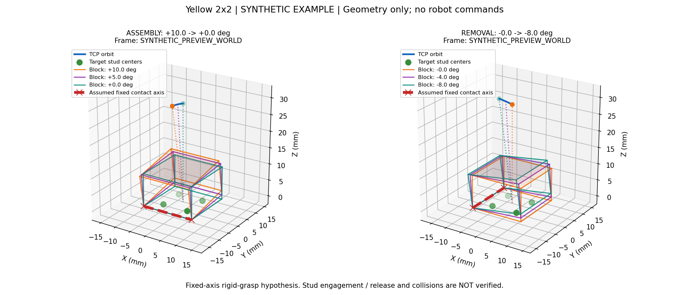

# 노랑4점 결착·분리 challenge 단계 설계

작업 checkout: `/home/rokey/Documents/ChatGPT/로봇제어 개발/c2_integration_challenge`

브랜치: `codex/integration-challenge`. 노랑 `2x2x1` 한 블록의 별도 시나리오이며 팀원의 Round2 기본 step/Plan/Current를 변경하지 않는다. [시나리오 입력·진행 기록](../robot_control_integration/settings/yellow4_challenge_20261014/scenario.json), [각 단계 실행 프롬프트](D_YELLOW4_CHALLENGE_PROMPTS_20261014.md)를 함께 사용한다. 0단계 완료는 설계/소프트웨어 준비 완료이며 실물 동작 완료가 아니다.

## 원리와 연구의 적용 범위

결착 방식은 **걸린 접촉부를 지점으로 회전하며 순차적으로 stud를 진입시키는 방식**이다. 체결 자체는 stud와 블록 밑면의 끼워맞춤이고 회전은 이를 수행하는 동작 전략이다. 수직축 yaw 비틀기만 하는 것이 아니라 접촉축에 대한 roll/pitch와 TCP XYZ 원호 이동을 함께 계산한다. 고정 TCP에서 자세만 바꾸면 블록의 접촉부가 미끄러질 수 있다.

사용자 영상/설명에서는 최초 접촉부가 stud에 걸려 더 밀리지 않고 이후 눕힌다. 이것은 작업자 관찰이며 자동 센서 판정은 아직 없다. 최초 모델은 고정 접촉선이지만 한 점 접촉/축 이동/그리퍼 미끄러짐이 보이면 관측에 맞춰 수정한다. 영상 속 아래 블록의 손 지지와 조립판 고정 조건도 다르다.

[CMU 2023 연구](https://arxiv.org/html/2305.15667)의 II-C/Fig.3은 전용 3D 프린트 도구의 부착·비틀기 동작을 제시한다. 직접 수직 인양하면 아래 구조까지 끌려갈 수 있다는 문제를 설명한다. 작업 순서의 역전과 접촉 궤적의 단순 역재생은 구분한다. RG2의 옆면 파지와 이 도구의 결합 방식은 다르므로 도구 동작/힘/성공률을 그대로 채택하지 않는다.

[부분 구속 삽입 연구](https://www.mdpi.com/2076-3417/11/16/7394)의 4.2/Fig.14는 접촉 가장자리를 중심으로 회전하는 삽입 전략의 참고다. LEGO 실물 검증이나 현재 장비의 접촉 파라미터를 제공하는 논문은 아니다. [CMU Eye-in-Finger 2025 연구](https://arxiv.org/html/2503.06848v1)의 III-D는 대상 위치 선관측→집기→놓기→검사를 분리한다. 그 논문의 전용 카메라/조명 반사 기반 roll/pitch 측정을 현재 D435i OpenCV 모서리 검출과 동일하게 취급하지 않는다.

분리는 **결착된 블록 재파지→반대편 stud부터 부분 해제→남은 결합 해제 확인→상승 회수**를 가설로 시험한다. 결착 때의 축/각도/힘을 분리용으로 그대로 복사하지 않는다. 판이 함께 들리거나 파지가 미끄러지는 경우를 분리 성공으로 기록하지 않는다.

## 개발 순서와 완료 기준

| 단계 | 개발/시험 내용 | 완료 증거 |
|---|---|---|
| 0 | 독립 범위, 상태 흐름, 증거 구분, 단계 프롬프트 적용 | 현재 브랜치·문서·JSON 정합성, 기존 preview 검사; 장치 명령 0 |
| 1 | 공급 파지/접촉축 관계를 받는 공통 기하, 결착·분리 별도 preview | 임의 축·좌표 변환·접촉점 불변량·회전 부호·원본 보존 테스트; 합성 표시 |
| 2 | 기존 교시/보정 읽기, 실제 TCP–블록 관계 확인, 관측 팝업/기록 | 출처 있는 좌표·영상·실측 관계와 잔여 미확인 값; 이동 없이 확인 |
| 3 | 실제 조립판보다 위로 평행 이동한 무접촉 원호·회전 경로 | 명령/실제 XYZ·SO(3) 자세·오차·피드백, 전체 경로 간섭/그리퍼 유지 확인 |
| 4 | 최초 stud 걸림과 짧은 부분 회전 결착 | 접촉부·회전 방향·파지 미끄러짐·반력/모멘트·지지 상태 관찰 |
| 5 | 회전 결착 전체, 개방/필요 시 닫힌 패드 누름, 개방 후 검사 | 실제 착좌/기울기/유지 결과; 명령 완료·45N 도달과 별도 판정 |
| 6 | 결착된 노랑 한 블록 재파지·부분 회전 분리 | 한쪽 해제와 남은 결합 구분, 판 고정·파지 유지·하부 구조 불변 확인 |
| 7 | 완전 분리 후 회수, 결착→검사→분리→검사 연결 | 목표 한 블록만 회수, 빈 목표/조립판 유지/회수 위치 검사와 반복 결과 |

1단계에서 양방향 기하를 함께 준비하되, 실물은 3→4→5의 결착을 먼저 검증하고 6→7의 분리를 진행한다. 동시에 두 물리 제어 루프를 실행하지 않는다. 횟수만 채우는 반복 제한을 넣지 않고 결과·영상·실제 피드백으로 판단한다.

## 좌표·관측·제어 연결

- 목표 예시 `(17,17), 1층`은 기존 사용자 지정/preview에서 이어받은 제안이다. 현재 실물 배치 확인으로 표시하지 않으며 각 단계에서 설정으로 바꿀 수 있다.
- 기존 supply/assembly teaching, grid calibration, 카메라 투영 데이터를 먼저 읽어 사용한다. 최초 파지부터 15mm 관계를 적용하는 사용자 +10mm 시험과 실측 프로파일은 구분한다. 이미 낮게 잡은 블록을 올려 같은 파지로 표시하지 않는다.
- 블록 좌표와 TCP의 상대 변환 및 접촉축을 명시한다. 입력 자세는 XYZ(mm)+ZYZ(deg), 물리 회전은 SO(3)로 비교한다. 파지 높이가 달라지면 TCP 기준 접촉축도 다시 계산한다.
- 관측 팝업은 블록 모서리, 기준 격자 방향, 접촉축, 예상 원호, 실제 자세/반력, 현재 상태를 구분해 표시한다. RGB 획득/ROI 입력 동안 ROS 피드백과 창 처리를 계속한다. 일시적 자료 지연은 정지 상태에서 대기하며 이미 보낸 이동을 재전송하지 않는다.
- yaw 각도 비교와 실제 윗면 roll/pitch는 별도다. 2D 모서리 기울기나 H/J/K 기준 자세 복귀만으로 실제 블록 평면 정렬을 확정하지 않는다. 확인된 평면 제공자가 있을 때 기존 ±0.50° 자동 보정을 연결한다.
- 의도적인 기울임/접촉축 회전 중에는 기존 자동 수평 복귀와 상쇄하지 않도록 상태를 분리한다. 접촉 회전 중 기존 XY 보정도 접촉축을 밀어내지 않게 한다.
- `app/edge_first_seating.py`의 waypoint는 원호지만 MoveL 구간은 chord 근사다. 샘플 간격에 따른 접촉부 오차와 실제 자세를 검사한다. H/J/K는 회전 표현/오차 계산만 재사용하고 실제 접촉축 제어의 검증으로 대신하지 않는다.

## 실물 기록과 진행 원칙

최소 기록은 run/stage/operation, 입력 출처와 프레임, UTC/피드백 시간, command/actual TCP, gripper 폭, raw wrench(Fx,Fy,Fz,Mx,My,Mz), 합력, 영상, 작업자 관찰, 상태 전이 이유다. 검출/분류 실패는 UNKNOWN으로 남기며 성공으로 바꾸지 않는다. 기존 B Current/revision을 이 시험 로그로 갱신하지 않는다.

기존45N은 위치 하강 누름의 raw 합력 중단값이다. 일정45N 유지 제어와 구분하며 최초 걸림/분리 감지값으로 사용하지 않는다. 접촉 회전의 속도·최대 각도·반력/모멘트 조건은 2~4단계 관측과 장비/파지 관계에서 지정하고 없는 실측값을 임의 정상값으로 채우지 않는다.

접촉/해제 판정은 초기 실물에서는 작업자 관찰과 로그를 연결한다. 자동 판정은 동일 시험 기록에서 검증된 경우에 연결한다. 압력이 줄었다는 이유만으로 ALL_STUDS_RELEASED나 SEATED로 전이하지 않는다. STOP/응답 미확정 시 기존 정지 처리를 유지하고 그리퍼를 자동 개방하거나 전체 동작을 재시도하지 않는다.

코드 준비와 실물 단계 완료는 각각 기록한다. 3~7단계는 사용자 실물 결과가 없는 동안 PREPARED_FOR_FIELD_TEST로 유지하며 단계 완료로 승격하지 않는다. 단계 완료 후 다음 프롬프트를 제공하고 사용자가 입력한 단계만 이어서 개발한다. 미확인 값은 그 값을 필요로 하지 않는 소프트웨어 작업을 막지 않는다.

## 1단계 산출물 — 공통 기하와 두 작업 preview

`app/edge_first_seating.py`에 v2 preview를 연결했다. 기존 v1 fixture/기본 CLI는 보존했다. v2는 하나의 노랑 블록과 별도로 지정된 assembly/removal 접촉축·각도·샘플 간격을 사용한다. 제거 preview의 끝은 부분 회전이며 전체 해제를 판정하거나 수직 회수하지 않는다.

### 입력 좌표의 의미

- `coordinate_frame`: seated block pose, 접촉축, 목표 stud 중심의 입력 프레임. 접촉축/stud의 `frame`이 다르면 변환을 명시해야 한다. camera/base로 추정하지 않는다.
- `output_frame`, `frame_pose_in_output_mm_zyz_deg`: 입력 프레임의 출력 프레임 내 자세 `T_output_frame`. 프레임 이름이 같으면 identity 변환을 사용한다. 출력 XYZ/자세/축/stud는 모두 출력 프레임 기준이다.
- `seated_block_pose_mm_zyz_deg`: 블록 기준 좌표의 입력 프레임 내 자세 `T_frame_block`.
- `tcp_to_block_pose_mm_zyz_deg`: **블록 좌표를 TCP 좌표로 옮기는** 강체 파지 변환 `T_tcp_block`. 블록 원점이 TCP에서 어디에 있는지 나타내며 base의 파지 pose가 아니다.
- `block_geometry`: 블록 로컬 XYZ의 순서 있는 네 바닥 모서리와 +Z 높이. `target_studs`는 네 중심의 입력 프레임 좌표다.
- `operations.assembly/removal`: 작업별 `contact_line` 두 점, 부호 있는 `tilt_deg`, 양의 `angular_step_deg`. 결착은 tilt→0, 분리는0→tilt로 각각 샘플링한다. 다른 작업의 축을 fallback으로 채우지 않는다.

계산 관계는 `T_output_block = T_output_frame × T_frame_block`, `T_output_tcp = T_output_block × inverse(T_tcp_block)`이다. 출력 프레임의 접촉축으로 TCP XYZ/자세를 함께 회전하고, 각 waypoint에서 `T_output_block = T_output_tcp × T_tcp_block`을 유지한다. 파지 관계를 바꾸면 TCP 원호가 바뀌며 같은 블록 회전 경로를 유지한다.

`chord_error_bound_mm`는 직선 TCP XYZ와 최단 SO(3) 자세 보간을 가정한 구간의 기하 오차 상한이다. 실제 MoveL 제어기 보간·접촉 유지의 실측 결과가 아니다. 샘플 간격은 설정으로 받으며 실제 접촉 시험에서 확인한다.

### 장치 연결 없는 실행

저장소 루트에서 두 작업의 JSON과 경로 그림을 함께 생성한다.

```bash
python3 robot_control_integration/scripts/yellow4_edge_first_preview.py \
  --config robot_control_integration/fixtures/yellow4_pivot_preview.json \
  --operation both \
  --output /tmp/yellow4-challenge-stage1-preview.json \
  --plot /tmp/yellow4-challenge-stage1.png
```

`--operation assembly` 또는 `--operation removal`로 한 작업만 출력할 수 있다. `--plot`은 PNG/SVG 파일을 저장하며 장치 창/카메라를 열지 않는다. 관측 팝업은 2단계 범위다. 실행 옵션/장치 명령은 없다. 그림 저장은 현재 환경의 Matplotlib을 사용하며 ROS/그리퍼 패키지를 추가하지 않았다.



길이·높이·축·10°/-8°는 합성 입력이다. 실제 치수·stud 걸림 위치·권장 각도로 채택하지 않는다. 빨간 선은 가정한 접촉축, 초록 점은 목표 stud 중심, 파란 원호는 TCP, 색상별 블록은 시작·중간·끝 자세다. 점선은 강체 파지의 TCP–블록 관계다. 접촉/간섭/체결/완전 해제는 이 그림으로 검증하지 않았다.
